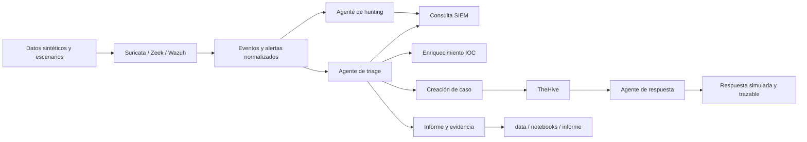

# Arquitectura propuesta

## Principios

- Despliegue reproducible mediante Docker Compose.
- Redes internas aisladas para los servicios del laboratorio.
- Datos sintéticos y escenarios controlados.
- Separación entre recolección, análisis, decisión y respuesta.
- Trazabilidad de entradas, herramientas invocadas, decisiones y resultados.
- Intervención manual para acciones con impacto antes de automatizarlas.

## Componentes

| Capa | Componentes previstos | Responsabilidad |
|---|---|---|
| Generación controlada | Scripts y datos sintéticos | Producir eventos reproducibles |
| Sensores | Suricata, Zeek y Wazuh | Generar telemetría y alertas |
| Análisis | SIEM o almacenamiento de eventos | Normalizar, consultar y correlacionar |
| Agentes | Triage, respuesta y hunting | Razonar sobre tareas acotadas y registrar trazabilidad |
| Herramientas | Consulta SIEM, enriquecimiento IOC, caso, informe y bloqueo simulado | Ejecutar acciones con contratos explícitos |
| Gestión de casos | TheHive y componentes compatibles | Registrar incidentes, observables y acciones |
| Evidencias | `data/`, `assets/`, `notebooks/` e `informe/` | Conservar resultados verificables |

## Flujo lógico

## Límites iniciales

La primera versión no ejecutará bloqueos reales ni acciones destructivas. Las herramientas de respuesta producirán acciones simuladas, con parámetros, autorización, resultado y evidencia.

La elección concreta de SIEM, almacenamiento, modelo local y mecanismo de RAG se validará durante el diseño de infraestructura. No se fijan credenciales ni resultados en esta fase.

## Preguntas abiertas

- ¿Qué combinación mínima de servicios cabe en el entorno disponible?
- ¿Qué formato común tendrán los eventos entre sensores y agentes?
- ¿Qué tareas requieren aprobación manual?
- ¿Qué modelo local será suficiente para los escenarios?
- ¿Qué evidencia será obligatoria para considerar válida una respuesta?
