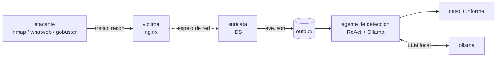

# Laboratorio 1 — Detección de reconocimiento automatizado con un agente de ciberdefensa

> Primer laboratorio del proyecto, lado **AZUL (defensivo)**. Un adversario
> emulado ejecuta reconocimiento contra una víctima en una red Docker aislada;
> un **sensor Suricata** lo observa y un **agente de IA con LLM local (Ollama,
> patrón ReAct)** lee las alertas, las clasifica, las mapea a MITRE ATT&CK, abre
> un caso y genera un informe de incidente. Materializa el flujo de
> [docs/02_arquitectura.md](../../docs/02_arquitectura.md) y se evalúa con las
> métricas de [docs/05_evaluacion.md](../../docs/05_evaluacion.md).

---

## 1. Contexto y fundamentación

El **reconocimiento** es la primera fase de la Cyber Kill Chain y la táctica
*Reconnaissance* (TA0043) / *Discovery* (TA0007) de MITRE ATT&CK: el adversario
recolecta información (puertos, servicios, versiones, tecnologías, rutas) antes
de explotar. Detectarlo temprano permite reaccionar antes del impacto.

Este laboratorio **no ataca**: el componente ofensivo es un *adversario emulado*
determinista cuyo único fin es generar telemetría realista para entrenar y medir
la **detección**. El objeto de estudio es el **agente defensivo**.

**Técnicas cubiertas:** `T1046` (escaneo de servicios/puertos), `T1592.002`
(fingerprinting de tecnologías), `T1595.003` (enumeración de rutas web).

## 2. Objetivos de aprendizaje

- **Desplegar** un entorno de detección reproducible (sensor + agente) sobre una
  red aislada. *(Aplicar)*
- **Analizar** la capacidad de un agente de IA para clasificar reconocimiento a
  partir de alertas de un IDS, con métricas objetivas. *(Analizar)*
- **Evaluar** cobertura, MTTD, precisión/recall, costo y límites del agente.
  *(Evaluar)*
- **Proponer** medidas defensivas de detección y reducción de superficie.
  *(Crear)*

## 3. Arquitectura del laboratorio



- **Red `interna` (`internal: true`):** `victima` y `atacante`, referenciados
  por nombre de servicio (DNS interno de Docker; sin IP fija, para no colisionar
  con otras redes del host). Sin salida a internet; nada accesible desde el host.
- **Sensor `suricata`:** comparte el namespace de red de la víctima para observar
  todo su tráfico; escribe alertas en `output/suricata/eve.json`.
- **Red `analitica` (aislada):** `agente` y `ollama`. El agente lee las alertas
  del volumen compartido y consulta el modelo local; no tiene internet. `ollama`
  tiene además una salida (`externa`) usada **solo** para descargar el modelo la
  primera vez (`ollama pull`).

## 4. Requisitos previos

- **Docker** y **Docker Compose** (Docker Desktop en Windows/Mac; en Windows,
  trabaja desde **WSL2**).
- ~**6 GB de RAM libres** y ~**4 GB de disco** para el modelo local.
- No requiere clave de API: el agente usa **Ollama local**.
- Conocimientos básicos de redes (IP, puertos) y línea de comandos Linux.

## 5. Montaje del entorno

**5.1. Configura el agente.** Desde esta carpeta (`labs/lab1_deteccion`):

```bash
cp .env.example .env
```

Los valores por defecto funcionan tal cual (modelo `llama3.2:3b` sobre el
servicio `ollama` del propio compose). Edita `.env` solo si quieres otro modelo.

**5.2. Levanta el entorno** (construye imágenes y arranca los 5 servicios):

```bash
docker compose up -d --build
```

**5.3. Descarga el modelo local** en el servicio Ollama (primera vez; tarda unos
minutos según tu conexión):

```bash
docker compose exec ollama ollama pull llama3.2:3b
```

**5.4. Verifica el aislamiento y que el sensor está activo:**

```bash
# El atacante resuelve y alcanza a la víctima en la red interna:
docker compose exec atacante nmap -p80 -Pn victima

# No hay salida a internet (no resuelve dominios externos):
docker compose exec atacante sh -c "getent hosts google.com && echo 'TIENE DNS externo (revisar)' || echo 'OK: red aislada'"

# El sensor está escuchando (debe listar la interfaz eth0):
docker compose logs suricata | tail -n 5
```

## 6. Desarrollo — Parte A: genera el reconocimiento (adversario emulado)

Lanza el guion de reconocimiento contra la víctima. Verás el escaneo en vivo y se
guardará el timeline en `output/atacante/`:

```bash
docker compose exec atacante python3 recon_sim.py
```

Comprueba que el sensor generó alertas:

```bash
grep '"event_type":"alert"' output/suricata/eve.json | wc -l
```

## 7. Desarrollo — Parte B: detección con el agente

Lanza el agente **varias veces** (se recomienda **n = 5** por el carácter no
determinista del LLM):

```bash
docker compose exec agente python3 agente_deteccion.py
```

El agente mostrará su ciclo ReAct en vivo (🧠 razonamiento, ⚙️ herramienta,
└─ observación) y al terminar imprime el veredicto. Cada corrida genera:

- `output/trazas/traza-<ts>.jsonl` — razonamiento paso a paso (trazabilidad).
- `output/casos/CASO-<ts>.json` — caso de incidente.
- `output/informes/informe-<ts>.md` — informe final con recomendaciones.
- `output/metricas/run-<ts>.json` — métricas de la corrida.

Para comparar otro modelo, edita `LAB_MODELO` en `.env` (p. ej. `qwen2.5:3b`),
descárgalo con `ollama pull` y repite.

## 8. Análisis y métricas

Agrega las métricas de todas las corridas (se ejecuta en el **host**, desde esta
carpeta):

```bash
python3 scripts/calcular_metricas.py
```

Calcula MTTD, cobertura ATT&CK, precisión/recall/F1, automatización y
reproducibilidad (docs/05_evaluacion.md), y guarda `output/metricas/resumen.json`.
Registra todo en [resultados.md](resultados.md) y responde sus preguntas.

## 9. Entregables

1. [resultados.md](resultados.md) completo (línea base + tabla de métricas de las
   n corridas + análisis).
2. La carpeta `output/` con alertas, trazas, casos, informes y métricas.
3. Un informe corto (puede ser la sección de análisis de `resultados.md`) que
   responda las preguntas de la sección 8.

## 10. Limpieza del entorno

```bash
docker compose down            # detiene y elimina los contenedores
docker compose down -v --rmi all   # además elimina imágenes y el modelo descargado
```

## Estructura de la carpeta

```
lab1_deteccion/
├── README.md                 # esta guía
├── docker-compose.yml        # red aislada + victima + suricata + atacante + agente + ollama
├── .env.example              # configuración del agente (copiar a .env)
├── resultados.md             # plantilla de hallazgos y métricas
├── atacante/
│   ├── Dockerfile
│   └── recon_sim.py          # adversario emulado (nmap/whatweb/gobuster)
├── sensor/
│   └── suricata/
│       └── rules/local.rules # reglas de detección de reconocimiento (ATT&CK)
├── agente/
│   ├── Dockerfile
│   ├── requirements.txt
│   ├── agente_deteccion.py   # agente ReAct sobre Ollama
│   ├── herramientas.py       # consultar_alertas, enriquecer_attack, crear_caso, generar_informe
│   └── attack_map.py         # mini base de conocimiento MITRE ATT&CK
├── scripts/
│   └── calcular_metricas.py  # agrega MTTD, precisión/recall/F1, cobertura
└── output/                   # (generado) evidencias de cada corrida
```

## Notas de seguridad

- Todo ocurre en redes Docker aisladas (`internal: true`); nada es accesible
  desde fuera y la víctima no tiene salida a internet.
- El adversario emulado tiene una **lista blanca** (`LAB_OBJETIVOS_PERMITIDOS`)
  que restringe el objetivo a la víctima del laboratorio.
- El agente **no ejecuta acciones con impacto**: solo observa, clasifica y
  documenta (límite definido en la arquitectura).
