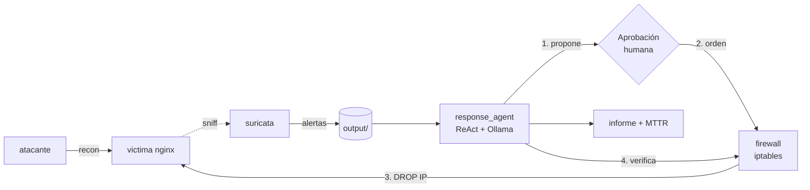

# Laboratorio 2 — Respuesta automatizada a incidentes (contención con agente)

> Segundo laboratorio, lado **AZUL (defensivo)**. Continúa el Lab 1: donde aquel
> **detecta** el reconocimiento, este **responde**. Un agente de IA (LLM local,
> patrón ReAct) identifica la IP atacante a partir de las alertas del sensor,
> **propone** la contención, **pide aprobación humana**, **ordena** el bloqueo a
> un firewall que lo **aplica con iptables** (reversible y auditado), **verifica**
> la contención y la **documenta** con MTTR. Materializa el flujo de respuesta de
> [docs/02_arquitectura.md](../../docs/02_arquitectura.md).

---

## 1. Contexto

Detectar no basta: hay que **contener**. Tras el reconocimiento (Lab 1), la
respuesta defensiva busca cortar al atacante antes de que avance. Aquí la acción
de contención es **bloquear la IP atacante**.

Dos principios de tu arquitectura guían el diseño:
- **Separación decisión/ejecución:** el agente *decide y ordena*; un **firewall**
  aparte *ejecuta*. El agente nunca tiene privilegios de red.
- **Intervención manual ante acciones con impacto:** el bloqueo requiere
  **aprobación humana** (human-in-the-loop) antes de aplicarse.

El bloqueo es **real pero contenido en el laboratorio** (red Docker aislada) y
**reversible** (`--rollback`): no toca ningún sistema externo.

**Técnica defensiva:** contención por bloqueo de red. Métrica estrella: **MTTR**.

## 2. Objetivos de aprendizaje

- **Ejecutar** una respuesta de contención automatizada y verificada. *(Aplicar)*
- **Analizar** el flujo decisión → aprobación → ejecución → verificación. *(Analizar)*
- **Evaluar** MTTR, tasa de contención, reversibilidad y falsos positivos. *(Evaluar)*
- **Discutir** los límites de automatizar acciones con impacto. *(Crear)*

## 3. Arquitectura



- **`interna` (aislada):** atacante, víctima, sensor y firewall.
- **`firewall`:** comparte el namespace de red de la víctima y aplica
  `iptables -I INPUT -s <ip> -j DROP`. Lee las órdenes de `output/ordenes/`.
- **`analitica` (aislada):** `response_agent` y `ollama`.

## 4. Requisitos previos

- Docker y Docker Compose; ~6 GB RAM libres.
- El modelo `llama3.2:3b` en Ollama (sin clave de API).

## 5. Montaje

```bash
cd labs/lab2_respuesta
cp .env.example .env
docker compose up -d --build
docker compose exec ollama ollama pull llama3.2:3b
```

> **Reutilizar el modelo del Lab 1 (evitar re-descargar 2 GB):** si ya hiciste el
> Lab 1, copia el modelo entre volúmenes antes del `pull`:
> ```bash
> docker run --rm \
>   -v lab1_deteccion_ollama_models:/from \
>   -v lab2_respuesta_ollama_models:/to \
>   alpine sh -c "cp -a /from/. /to/"
> ```

Verifica el firewall activo:

```bash
docker compose logs firewall | tail -n 3   # "firewall activo. Vigilando ..."
```

## 6. Desarrollo

### Parte A — generar el incidente (reconocimiento del Lab 1)

```bash
docker compose exec atacante python3 recon_sim.py
```

Comprueba que el atacante **sí** alcanza a la víctima (antes del bloqueo):

```bash
docker compose exec atacante nmap -p80 -Pn victima   # 80/tcp open
```

### Parte B — respuesta con el agente (⭐)

```bash
docker compose exec response_agent python3 response_agent.py
```

El agente mostrará su ciclo ReAct y, al proponer el bloqueo, **pedirá tu
aprobación por teclado** (human-in-the-loop). Al aprobar, el firewall aplica el
bloqueo y el agente lo verifica. Genera:

- `output/ordenes/ORD-*.json` — la orden de bloqueo (con autorización y resultado).
- `output/firewall/estado.json` — estado del firewall (IPs bloqueadas, reglas).
- `output/informes_respuesta/informe-respuesta-*.md` — informe con MTTR.
- `output/metricas/run-*.json` — métricas de la corrida.

> Para corridas de métricas sin teclado, pon `LAB_AUTO_APROBAR=true` en `.env`.

### Parte C — demostrar la contención (antes/después)

```bash
docker compose exec atacante nmap -p80 -Pn victima   # ahora 80/tcp filtered
```

El mismo escaneo que antes funcionaba **ahora falla**: el atacante está contenido.

### Parte D — revertir (reiniciar la demo)

```bash
docker compose exec response_agent python3 response_agent.py --rollback
```

## 7. Métricas

```bash
python3 scripts/calcular_metricas.py
```

Calcula MTTR, tasa de contención, falsos positivos de respuesta, reparto de
aprobación, reversibilidad y reproducibilidad. Registra todo en
[resultados.md](resultados.md).

## 8. Entregables

1. `resultados.md` con métricas y análisis.
2. `output/` con órdenes, estado del firewall, informes y métricas.
3. Evidencia del antes/después del bloqueo (capturas de los dos `nmap`).

## 9. Limpieza

```bash
docker compose down            # detiene los contenedores
docker compose down -v --rmi all   # además borra imágenes y el modelo
```

## Estructura de la carpeta

```
lab2_respuesta/
├── README.md / EXPOSICION.md / resultados.md
├── docker-compose.yml
├── .env.example
├── atacante/              # adversario emulado (reusa el del Lab 1)
├── sensor/suricata/rules/ # reglas de detección (reusa el del Lab 1)
├── firewall/
│   ├── Dockerfile
│   └── enforcer.py        # aplica/revierte iptables (EJECUCIÓN)
├── agente/
│   ├── Dockerfile, requirements.txt
│   ├── response_agent.py  # agente ReAct de respuesta (DECISIÓN)
│   └── herramientas.py    # consultar_incidente, bloquear_ip, verificar, informe
├── scripts/calcular_metricas.py
└── output/                # (generado) evidencias
```

## Notas de seguridad

- El bloqueo es **real pero dentro de la red aislada** del laboratorio y
  **reversible**; no afecta a ningún sistema externo.
- El agente no ejecuta `iptables`: solo emite órdenes que el firewall valida
  (comprueba que la IP es válida) y aplica. Toda acción con impacto pasa por
  **aprobación humana**.
