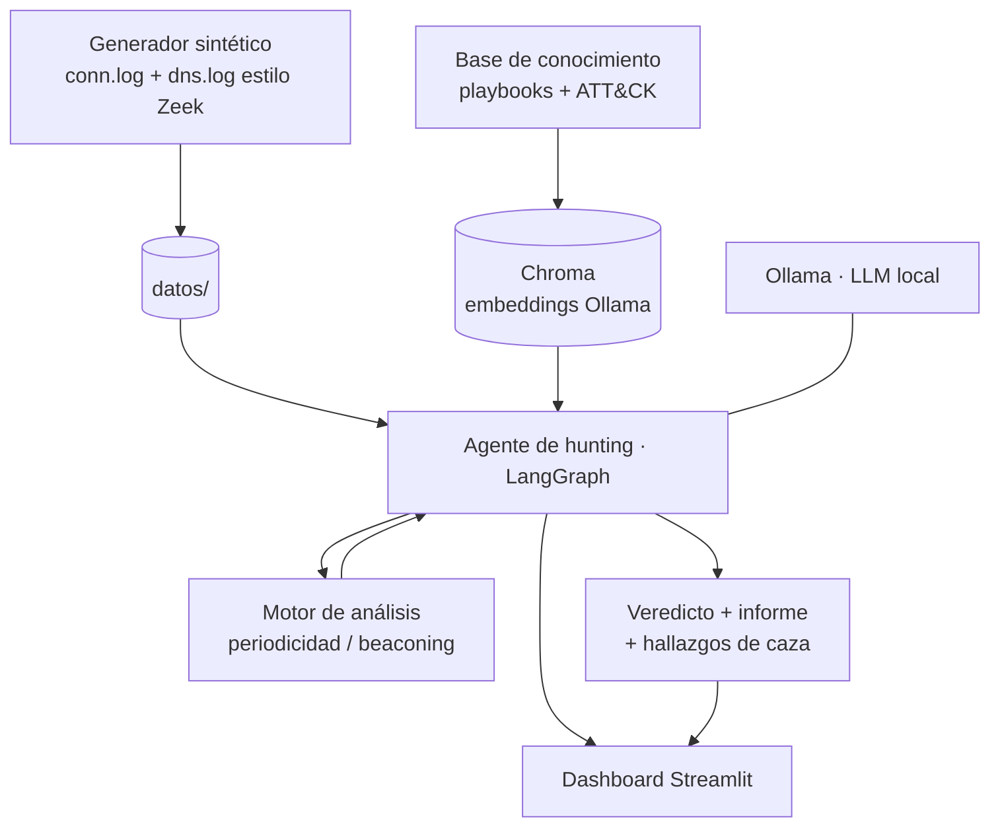

# Lab 3 — Threat Hunting proactivo con agente (documento de diseño)

> Documento de diseño / ADR del tercer laboratorio. Define alcance, arquitectura,
> componentes, el flujo del agente, la interfaz visual, las métricas y el plan de
> construcción por fases. Sirve de hoja de ruta antes de implementar.

## 1. Idea y salto de complejidad

Los labs anteriores son **reactivos**: el Lab 1 clasifica alertas que ya saltaron;
el Lab 2 responde a un incidente. El Lab 3 es **proactivo**: **no hay alerta**. El
agente **formula hipótesis y busca** una amenaza que **evade las firmas** del IDS.

**Decisiones de alcance (acordadas):**
- **Amenaza a cazar:** C2 *beaconing* (una máquina comprometida "llama a casa" a
  intervalos regulares hacia un servidor de mando y control).
- **Palancas de complejidad:** LangGraph (agente multi-paso), RAG (base de
  conocimiento con Chroma + embeddings locales), interfaz Streamlit, y
  correlación multi-fuente (logs estilo Zeek: conexiones + DNS).
- **Datos:** sintéticos y deterministas (reproducibles, alineados con `AGENTS.md`).

**Por qué el beaconing es el caso ideal:** cada conexión parece tráfico normal, así
que **ninguna regla salta**; solo el **patrón temporal** (periodicidad, baja
varianza entre conexiones) lo delata. Es el caso de hunting más claro, elegante y
visual, y demuestra que el agente **aporta sobre el IDS**.

**Técnicas MITRE ATT&CK:** T1071 (Application Layer Protocol / C2),
T1571 (Non-Standard Port), T1008 (Fallback Channels); apoyo en T1029 si se simula
exfiltración programada.

## 2. Escenario

En una ventana de ~1 hora de tráfico sintético conviven:
- **Ruido normal:** navegación web a muchos destinos, intervalos irregulares.
- **Tráfico periódico legítimo:** p. ej. NTP cada ~1024 s (para que la periodicidad
  por sí sola no baste: el agente debe razonar, no solo medir).
- **El beacon oculto:** un host interno → una IP/dominio "C2" cada ~60 s con *jitter*
  pequeño, durante toda la ventana (~60 conexiones, varianza muy baja).

**Expectativa (ground truth):** el agente debe **encontrar el beacon**, **descartar**
el NTP legítimo como benigno y **no inventar** amenazas en el ruido.

## 3. Arquitectura



- **Separación clave:** el **análisis cuantitativo** (periodicidad) es Python
  **determinista** (no lo "adivina" el LLM); el LLM **orquesta, interpreta y
  fundamenta** apoyándose en el RAG. Esto evita alucinaciones en lo numérico.

## 4. Componentes

### 4.1. Generador de datos sintéticos (`datos/generar_trafico.py`)
Produce logs en **formato Zeek** (TSV/JSON) reproducibles con una semilla fija:
- `conn.log`: `ts, src_ip, dst_ip, dst_port, proto, duration, orig_bytes, resp_bytes`.
- `dns.log`: `ts, src_ip, query, qtype, answer`.
Inserta el beacon, el NTP legítimo y el ruido. Un manifiesto `ground_truth.json`
declara qué pares son beacon/benigno (para medir sin trampas).

### 4.2. Motor de análisis (`agente/analisis.py`)
Función determinista de *beaconing scoring* por par (src, dst):
- Ordena timestamps, calcula intervalos (*inter-arrival*), media, desviación y
  **coeficiente de variación (CV = σ/μ)**.
- **Señal de beacon:** CV bajo (p. ej. < 0,15) + nº de conexiones ≥ umbral +
  regularidad del *jitter*. Devuelve candidatos **rankeados** por puntuación.
- Expuesto como **herramienta** del agente (no como razonamiento del LLM).

### 4.3. RAG — base de conocimiento (`conocimiento/` + `agente/rag.py`)
- `conocimiento/`: *playbooks* de caza en Markdown (beaconing, DNS tunneling,
  movimiento lateral) + fichas ATT&CK. Son el "saber experto".
- `rag.py`: indexa esos documentos en **Chroma** (persistente, embebido) usando
  **embeddings locales de Ollama** (`nomic-embed-text`). El agente **recupera** el
  playbook relevante para fundamentar su procedimiento y el mapeo ATT&CK.

### 4.4. Agente de hunting — LangGraph (`agente/grafo.py`, `agente/hunter.py`)
Grafo de estados con **ciclo de refinamiento** (más que un bucle ReAct simple):

```
          ┌───────────────┐
          │ plan_hipotesis│  (LLM propone: ¿beaconing? ¿DNS tunneling?)
          └───────┬───────┘
                  ▼
          ┌───────────────┐
          │ recuperar_rag │  (Chroma: playbook + ATT&CK de la hipótesis)
          └───────┬───────┘
                  ▼
          ┌───────────────┐
          │ recolectar    │  (carga conn.log/dns.log, agrupa series)
          └───────┬───────┘
                  ▼
          ┌───────────────┐
          │ analizar      │  (motor de periodicidad → candidatos)
          └───────┬───────┘
                  ▼
          ┌───────────────┐      evidencia débil
          │ evaluar_evid. │────────────────────────┐
          └───────┬───────┘                         │ (refina: amplía ventana,
                  │ evidencia suficiente            │  prueba otra hipótesis;
                  ▼                                  │  máx. N iteraciones)
          ┌───────────────┐                         │
          │ veredicto +   │◄────────────────────────┘
          │ informe       │  (LLM, fundamentado en RAG + análisis)
          └───────────────┘
```

**Estado del grafo:** hipótesis, conocimiento recuperado, candidatos, evidencia,
nº de iteraciones, veredicto. Todo se registra como **traza** (trazabilidad).

### 4.5. Interfaz visual — Streamlit (`ui/app.py`)
Dashboard donde se **ve** al agente trabajar (lo que pediste). Secciones:
1. **Control:** botón "Ejecutar cacería", selector de modelo, estado.
2. **Fuentes de datos:** resumen de `conn.log`/`dns.log` (volúmenes, nº de pares).
3. **Razonamiento del agente:** los nodos del grafo en vivo (hipótesis →
   conocimiento → análisis → evaluación → veredicto), con la traza.
4. **Evidencia visual:** **gráfica de la serie temporal** del par sospechoso
   (los "latidos" regulares del beacon vs el tráfico irregular) + tabla de
   candidatos con CV y puntuación.
5. **Veredicto:** amenaza encontrada, mapeo ATT&CK, informe y recomendaciones.

## 5. Métricas (docs/05_evaluacion.md)

| Métrica | Qué mide |
|---|---|
| **Recall de caza** | ¿Encontró el beacon sembrado? (sobre el ground truth) |
| **Precisión / Falsos positivos** | ¿Marcó como amenaza algo benigno (NTP, ruido)? |
| **Cobertura ATT&CK** | Técnicas correctamente identificadas |
| **Tiempo de caza** | Desde el inicio hasta el veredicto |
| **Profundidad de razonamiento** | Nº de iteraciones del grafo hasta concluir |
| **Fundamentación (RAG)** | ¿Citó el playbook recuperado? (grounding, anti-alucinación) |
| **Reproducibilidad** | Resultado estable en n corridas (semilla fija, temperatura 0) |

## 6. Estructura de archivos propuesta

```
labs/lab3_hunting/
├── DISENO.md                 # este documento
├── README.md / EXPOSICION.md / resultados.md
├── docker-compose.yml        # ollama + hunter (agente + Streamlit)
├── .env.example
├── datos/
│   └── generar_trafico.py    # genera conn.log, dns.log, ground_truth.json
├── conocimiento/             # playbooks md para el RAG
│   ├── beaconing.md
│   ├── dns_tunneling.md
│   └── att_ck_c2.md
├── agente/
│   ├── analisis.py           # motor de periodicidad (determinista)
│   ├── rag.py                # Chroma + embeddings Ollama
│   ├── grafo.py              # LangGraph (nodos + ciclo)
│   ├── herramientas.py
│   ├── hunter.py             # ejecución por CLI
│   └── requirements.txt
├── ui/
│   └── app.py                # dashboard Streamlit
├── scripts/
│   └── calcular_metricas.py
└── output/                   # trazas, informes, métricas, gráficas
```

Rellena `agents/hunting_agent/` del scaffolding.

## 7. Requisitos técnicos

- Docker + Compose; ~8 GB RAM libres (LLM + embeddings + Streamlit).
- Ollama con dos modelos: `llama3.2:3b` (razonamiento) y `nomic-embed-text`
  (embeddings del RAG). Ambos locales, sin claves.
- Puerto `8501` expuesto al host para el dashboard Streamlit.
- Dependencias Python nuevas: `langgraph`, `langchain-core`, `chromadb`,
  `streamlit`, `pandas`, `plotly` (o `altair`), `ollama`.

## 8. Plan de construcción por fases

1. **Datos:** generador sintético + `ground_truth.json` + verificación.
2. **Análisis:** motor de beaconing determinista + pruebas unitarias.
3. **RAG:** base de conocimiento + indexado en Chroma + recuperación.
4. **Agente:** grafo LangGraph que orquesta hipótesis → RAG → análisis → veredicto.
5. **Interfaz:** dashboard Streamlit sobre el agente.
6. **Evaluación:** métricas + corrida end-to-end real + README/EXPOSICION/resultados.

Cada fase deja evidencia y se prueba antes de pasar a la siguiente (como en los
Labs 1 y 2).

## 9. Riesgos y mitigaciones

- **LangGraph con modelo pequeño:** el grafo controla el flujo (nodos fijos), así
  que el LLM solo decide dentro de cada nodo; el análisis numérico es Python. Baja
  el riesgo de que el modelo "se pierda".
- **RAG lento o pesado:** Chroma embebido + base de conocimiento pequeña (pocos
  documentos) → indexado en segundos.
- **Tiempos en CPU:** mismo cuello de botella que los labs anteriores; se mitiga con
  corrida de calentamiento y, si hace falta, cacheo de embeddings.
- **Streamlit y Docker:** exponer solo el 8501; el resto de la red, aislado.

## 10. Entregables del Lab 3

1. Dashboard Streamlit funcional (demo visual).
2. `resultados.md` con métricas reales y análisis.
3. `output/` con trazas, informes y la gráfica del beacon.
4. README + EXPOSICION (guion de presentación).
